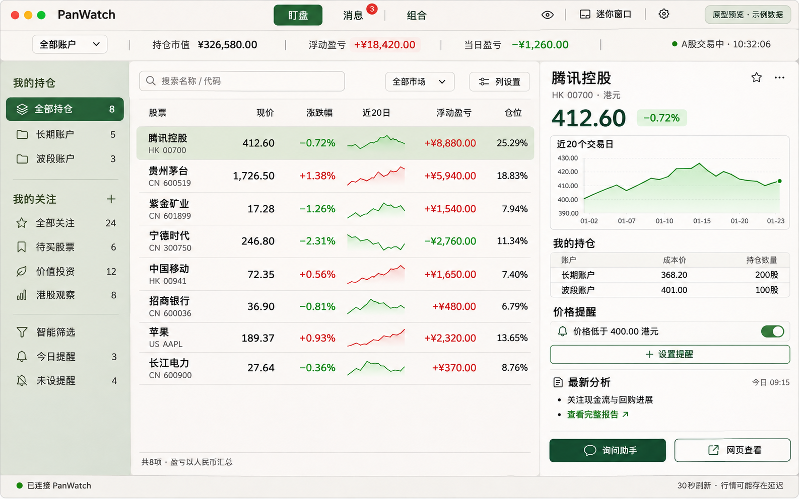

# PanWatch macOS 桌面端具体实施方案

版本：1.0 
状态：核心桌面端已实现；真实 macOS 窗口验收、最终交付状态见第 13 节
适用项目：PanWatch 现有仓库 
开发路线：Swift / AppKit + WKWebView + React / TypeScript + 现有 Python / FastAPI 服务

## 1. 目标、范围与交付形式

将现有基础桌面窗口升级为持仓与关注股票的盯盘工作台，完成“查看变化 → 查看股票详情 → 设置提醒 → 接收通知 → 打开原始分析”的使用路径。

最终交付：可运行的 PanWatch.app、DMG 安装包、版本说明、安装与连接说明、业务验收报告。

本轮采用连接已有 PanWatch 服务的客户端。服务地址可为本机或远程部署；客户端安装不代表 Python 后端已安装或自动启动。自动捆绑本地服务、券商接入、实盘下单和完整策略编辑不进入本轮范围。

本文件集中给出执行顺序、模块分工、接口建议、验收条件和发布要求，可独立用于安排开发。此前功能与整体设计文档作为背景参考；存在差异时，以本文件的具体范围与验收规则为准。

## 2. 当前基础与改造起点

| 当前代码 | 已有能力 | 实施动作 |
|---|---|---|
| macos/PanWatch/main.swift | AppKit 窗口、Dock 恢复、WebKit 消息桥、原生请求 | 拆分窗口、桥接、网络、会话模块 |
| macos/PanWatch/APIResponse.swift | 服务响应解析、登录前服务识别 | 复用并补统一错误类型 |
| macos/PanWatch/Resources/watch.html、watch.js | 基础列表、账户/市场分组、搜索、刷新 | 逐步由 React 桌面入口替换 |
| macos/build.sh | 当前架构编译、本地临时签名 | 增加前端构建、版本信息、正式签名及打包 |
| frontend/packages/api/src/client.ts | 网页请求、localStorage 会话、401 网页跳转 | 分离传输及会话策略，保留网页默认行为 |
| frontend/packages/biz-ui | 提醒表单、K 线、分析阅读器等 | 验证组件依赖后按需复用 |
| frontend/src/lib/portfolio-quotes.ts | 桌面可参考的行情、汇率及持仓计算 | 收敛共享展示规则，避免重复计算口径 |
| 现有后端 | 持仓、关注、报价、提醒、通知、分析、策略 | 优先复用，补共享关注分组和必要聚合接口 |

当前仅有基础桌面能力；菜单栏、钥匙串、跨端自定义分组、DMG 正式分发等为待开发项。开发前重新查看仓库状态，保留现有其他任务的修改。

## 3. 产品结构与界面要求

### 3.1 主窗口

主导航：盯盘、消息、组合、设置。

- 顶部：当前账户范围、市值、浮动盈亏、当日盈亏、行情更新时间、隐私开关。
- 左侧：全部持仓、各账户、自定义关注组、置顶、智能筛选。
- 中间：股票表格，支持搜索、排序、自定义列、手动顺序。
- 右侧：股票详情，展示行情、走势、账户明细、提醒、报告及网页入口。
- 底部：服务状态、最近事件和失败重试入口。

初始尺寸参考 1180×780。窄窗口进入单栏详情并提供返回按钮；恢复列表时保留分组、滚动和排序状态。

默认列：股票名称/代码、现价、涨跌幅、浮动盈亏、当日盈亏、仓位、提醒状态。可选列：成本、股数、市值、交易风格、分析时间、近20个交易日走势。

账户选择改变顶部汇总；名称搜索只过滤表格并显示匹配数量，不改变账户总览。智能筛选使用匹配范围汇总，并明确标注范围。

### 3.2 原生入口

- Dock：恢复主窗口，保持上次选中内容。
- 菜单栏：默认图标，可选显示一个账户盈亏或一只股票涨跌幅；小窗展示置顶列表、最新事件及主窗口入口。
- 迷你窗口：显示选定分组，可置顶、切组、隐藏金额；独立记住窗口位置。
- 快捷键：可配置唤起/收起，冲突时提示修改，失败不显示为已启用。
- 关闭窗口继续驻留；⌘Q 完全退出，终止本机轮询。

## 4. 技术架构与代码落点

### 4.1 Swift 原生层

建议新增并逐步迁移，不一次性重写全部入口：

| 模块 | 责任 |
|---|---|
| AppCoordinator | 启动、退出、Dock 恢复及应用状态 |
| WindowCoordinator | 主窗口、迷你窗口、置顶、位置恢复 |
| DesktopBridge | 命令校验、请求编号、结果及事件回传 |
| APIClient | 服务验证、认证请求、超时、错误、取消 |
| SessionStore | 内存会话、钥匙串持久化、过期与退出登录 |
| MarketDataCoordinator | 去重批量请求、市场状态、多窗口行情分发 |
| NotificationCoordinator | 事件游标、去重、系统通知、点击定位 |
| MenuBarController | 菜单栏展示及小窗生命周期 |
| PreferencesStore | 设备偏好、快捷键、通知与隐私设置 |

代码建议位于 macos/PanWatch 对应子目录；main.swift 保留最小启动逻辑。构建脚本需同步纳入新增 Swift 源文件。

### 4.2 桌面网页层

在现有 frontend 增加桌面入口，例如 desktop.html、src/desktop/main.tsx、DesktopApp.tsx，以及 pages、components、bridge、state 子目录。

增加独立桌面构建配置，输出到 frontend/dist-desktop，再复制至 .app 的 Resources/Web。桌面资源采用相对路径及不依赖服务端重写的路由方式。网页现有入口、构建及部署路径保持可用。

本地加载方式先验证 WKWebView 对模块、动态加载和图表资源的支持。若 file URL 存在限制，使用仅服务应用打包资源的受限 WKURLSchemeHandler；不暴露任意文件读取。此验证必须先于大量页面迁移。

### 4.3 跨端复用

- API 类型与业务调用保留在 frontend/packages/api；增加可注入传输及会话策略。
- 网页继续使用现有 fetch、localStorage 和登录跳转；桌面请求通过原生桥，401 回到桌面连接页。
- 桌面保留取消请求、超时、统一错误和语言能力；桥接取消需同步到原生 URLSessionTask。
- 共享提醒表单、图表、报告阅读器；组件依赖的浏览器全局行为先隔离。
- 盈亏、币种、交易日和报价状态优先由服务端统一；不在 Swift 和桌面页面各写一套业务算法。

### 4.4 桥接协议

请求包含协议版本、requestId、受限 action、payload；响应包含 requestId、成功状态、data 或结构化 error。状态事件包含事件类型和数据版本。

建议动作：session.connect、session.restore、session.logout、portfolio.load、stocks.load、groups.save、alerts.save、window.setMode、privacy.set、web.openRecord。

只接受打包可信页面和合法参数。将业务动作映射到允许的 API 路径、方法及字段；页面不能传任意 URL、Authorization 或本机命令。长期令牌仅由原生层持有。

页面导航到外部地址不继续携带原生桥能力；外部报告交给系统浏览器。网页跳转携带业务记录标识，不在 URL 中传令牌。

## 5. 服务端与数据改造

### 5.1 复用接口

继续使用 /api/auth/status、/api/auth/login、/api/stocks、/api/portfolio/summary、/api/quotes/batch、/api/stocks/markets/status。提醒、通知、历史报告、组合诊断和策略使用项目现有 API，开发时核对其实际参数与分页契约。

当需要股票详情时，先并行读取已有接口；仅在请求碎片化明显时增加聚合接口。基本行情不等待 AI 结果。

### 5.2 共享关注分组（新增接口建议）

以下接口为拟定契约，实施时与现有后端风格统一，并非已存在：

| 方法与路径 | 功能 |
|---|---|
| GET /api/watch-groups | 返回组、版本及成员列表 |
| POST /api/watch-groups | 创建分组 |
| PATCH /api/watch-groups/{id} | 修改名称等属性，携带版本 |
| DELETE /api/watch-groups/{id} | 删除分组，保留关注和持仓 |
| PUT /api/watch-groups/order | 原子更新分组顺序 |
| PUT /api/watch-groups/{id}/members | 原子更新成员及组内顺序，携带版本 |

数据建议：WatchGroup(id、name、sort_order、version、created_at、updated_at)；WatchGroupMember(group_id、stock_id、sort_order)，成员联合唯一。若现有部署有用户/租户隔离，必须继承同样的数据边界。

同一股票可属于多组。移出组只删除成员关系；删除账户或取消关注沿用既有业务约束。排序批量校验重复 ID、非法成员及越界范围，整体事务保存。并发版本不符返回冲突，客户端提示刷新，不覆盖另一端变更。

数据库迁移沿用现有项目机制；旧关注列表继续可读，“全部关注”为动态视图，不要求每只旧股票迁移到某个人工分组。新旧网页和桌面版本混用时，新增接口缺失应提示升级服务并降级显示已有列表。

## 6. 会话、同步与计算规则

### 6.1 登录与连接

1. 规范化并检查服务地址。
2. 请求服务识别接口，验证响应结构与账号初始化状态。
3. 验证成功后才向该服务提交登录凭证。
4. 默认令牌只存内存；用户选择保持登录后存钥匙串。
5. 钥匙串按服务标识和账号隔离；切换服务取消旧请求并清空旧业务视图。
6. 恢复会话后校验有效性，过期统一回到连接页。
7. 退出登录取消请求、清除会话及敏感缓存。

网络层不允许凭证随跨服务重定向发送；错误提示区分连接失败、服务不匹配、密码错误、凭证过期和服务端失败。

### 6.2 数据同步

服务端保存持仓、关注、分组、提醒、消息已读和报告；窗口位置、列配置、迷你模式等设备偏好保存在 Mac。

先加载账户和关注元数据，再请求去重行情，最后加载图表、报告和策略摘要。切换股票用请求代次或取消机制过滤旧结果。

所有窗口共用原生行情协调器；同一市场及代码只请求一次。初始刷新候选值：前台交易中30秒、后台120秒、休市5分钟；实际值按数据源限制调整，界面说明行情更新时间。手动刷新复用在途请求；失败指数退避，恢复网络或唤醒后重新判断市场状态。

### 6.3 计算与展示

- 股票标识为 market + symbol，合并多账户时使用加权成本并可展开明细。
- 现价及成本使用原币，汇总默认人民币；汇率缺失不默认补固定值。
- 服务端返回已确认的盈亏口径；涉及日内交易和现金流时，单凭当前股数及涨跌幅只能作估算，不展示成精确账户收益。
- 缺失报价不补零；总览不完整时明确说明范围及缺失项。
- 区分交易中、休市收盘快照、行情过期和不可用；显示对应交易日期。
- 日线标记近20个交易日；分时图必须由真实分钟数据生成，不能用日线或随机曲线代替。
- 隐私模式覆盖主窗口、菜单栏、迷你窗口；通知金额另提供隐藏设置。

## 7. 分阶段任务清单

### 阶段 A：工程与会话基础（V0.2 前置）

| 编号 | 任务及代码范围 | 完成条件 |
|---|---|---|
| A1 | 验证本地 React 资源加载；新增桌面入口和构建配置 | 打包后离开开发服务器仍能加载页面及资源，网页构建通过 |
| A2 | 拆分 Swift 网络、桥接和窗口模块 | 原有登录、列表、Dock 恢复行为保持可用 |
| A3 | API 传输和会话适配 | 桌面不依赖 localStorage 令牌或网页登录重定向，取消/超时生效 |
| A4 | 钥匙串、服务隔离、错误处理 | 可选恢复登录，切服务无旧数据泄漏，错误端口不提交凭证 |

依赖：A1 验证通过后迁移页面；A2/A3 确定契约后接入业务；A4 完成后进入持久会话验收。

### 阶段 B：完整盯盘（V0.2）

| 编号 | 任务 | 完成条件 |
|---|---|---|
| B1 | 分组模型、迁移、接口及网页版管理入口 | 跨端创建/改名/排序/成员修改一致，旧数据兼容 |
| B2 | 桌面导航、表格、搜索、列设置、账户合并 | 汇总范围明确，排序稳定，刷新不重置操作状态 |
| B3 | 股票详情：行情、账户明细、已有报告入口 | 切换无串数据，各区独立加载，报告时间清晰 |
| B4 | 日线小走势与详情图 | 真实数据、交易日标注、失败有空态 |
| B5 | 隐私、连接状态、退避重连及设备偏好 | 金额隐藏覆盖完整，断线保留旧数据且标明时间 |

依赖：B1 依赖 A3，B2 可先接已有账户后接分组；B3/B4 依赖 B2 选中状态与共享接口；B5 在完整列表接入后验收。

阶段交付：可运行 V0.2 应用、更新后的网页分组能力、测试报告、开发试装 DMG。图表数据不满足时，明确列为未完成项，不能用模拟内容验收。

### 阶段 C：原生体验与提醒（V0.3）

| 编号 | 任务 | 完成条件 |
|---|---|---|
| C1 | 统一行情协调器、菜单栏、迷你置顶 | 多窗口不重复轮询，生命周期及隐私设置一致 |
| C2 | 全局快捷键和可选开机启动 | 设置可关闭，冲突和系统版本限制有反馈 |
| C3 | 快速提醒创建/编辑/暂停，复用网页表单 | 规则在网页可见，失败不误报保存成功 |
| C4 | 消息列表、事件游标、系统通知、点击定位 | 同事件不重复通知，历史消息不集中弹出，已读跨端同步 |

依赖：C1 依赖 B2/B5；C3 复用服务端规则；C4 依赖稳定会话、事件标识和股票定位。

通知权限在用户启用时请求。拒绝后保留站内消息。关闭窗口仍可驻留；休眠和完全退出不能保证本机实时通知，服务端独立运行时继续既有监控。

### 阶段 D：研究联动（V0.4）

| 编号 | 任务 | 完成条件 |
|---|---|---|
| D1 | 组合诊断、集中度及收益贡献卡片 | 口径与网页一致，缺失数据不形成确定结论 |
| D2 | 最新报告、主动分析、任务进度与助手入口 | 不随行情刷新调用 AI，重复操作不重复创建任务 |
| D3 | 持仓/关注关联策略摘要及网页定位 | 显示信号日期、快照状态和来源记录 |
| D4 | 分钟级分时图数据接入及缓存 | 覆盖市场时段、缺口、休市、跨日与数据源失败 |

D4 单独以数据可用性为前提，不阻塞 D1–D3；若未满足，版本说明明确分时功能未交付。模拟交易记录不得混入真实持仓汇总。

## 8. 验证与验收清单

| 范围 | 必须覆盖的业务场景 |
|---|---|
| 登录 | 正确服务、错误端口、服务未启动、密码错误、过期、取消保持登录、切换服务 |
| 分组 | 创建、重名策略、多组归属、移出成员、删组保留股票、并发冲突、旧版本降级 |
| 持仓 | 同股多账户、A/H/美股、成本为零、缺失行情/汇率、数量变化、当日交易口径 |
| 交互 | 排序后刷新、快速切股、空组、搜索、窄窗口、恢复位置及隐私状态 |
| 网络 | 超时、取消、断线重连、唤醒、后台刷新、旧响应晚到 |
| 提醒 | 新增/编辑/暂停、跨端同步、冷却和次数限制、保存失败 |
| 通知 | 去重、未读同步、拒绝权限、点击定位、离线补齐、关闭窗口与完全退出 |
| 原生 | Dock 重开、菜单栏、迷你置顶、快捷键冲突、开机启动关闭 |
| 安装 | DMG 挂载、拖入应用程序、首次启动、旧版覆盖、卸载、服务不可达 |

自动检查：保持现有前后端检查通过；为新增分组事务、并发冲突、会话隔离、桥接白名单、数据计算和通知去重补必要测试。现有 macos/tests 作为回归基础，按实际模块拆分更新。

真实验收：启动隔离测试服务，使用指定测试账号和可识别的测试持仓；操作真实 .app 窗口，记录场景、结果、截图及失败项。不得只以脚本通过代替真实窗口验证。执行完整交付时按项目本地交付流程生成证据及报告。

每期通过标准：该期关键业务场景通过、无阻断问题、无未说明的数据错误；未通过项列清楚，不能声称整期完成。

## 9. DMG 构建与发布实施

按以下顺序扩展 macos/build.sh，并将发布动作拆为独立脚本或明确模式：

1. 校验版本号、构建号、资源和目标架构。
2. 执行桌面前端构建，复制到 .app 资源目录。
3. 编译 Swift，写入 Info.plist、应用图标及版本信息。
4. 验证打包资源、架构和最低系统版本；仅承诺实际验证过的系统。
5. 开发版使用当前本地签名；正式分发使用开发者提供的 Developer ID 凭证签名并验证。
6. 使用包含 .app 和 Applications 快捷入口的目录制作 DMG。
7. 正式版完成公证并附加票据；对最终 DMG 和其中应用执行验证。
8. 挂载最终安装包，在目标 Mac 上执行拖入、首次启动、连接、Dock 恢复及覆盖升级验收。
9. 生成版本说明、校验值、已知限制及验收报告。

建议产物名：PanWatch-版本号-arm64.dmg / PanWatch-版本号-x86_64.dmg；通用包仅在两种架构及依赖均实际验证后使用。

签名凭证和公证权限由用户提供，保存在本机安全位置或发布系统中，不写入仓库。没有凭证时可交付标明限制的本地试装包，不宣称已完成正式公证。

初期采用手动更新，用户退出旧应用后覆盖 .app；保留服务地址及用户选择保存的会话。服务端数据库不随桌面覆盖安装删除或回退。自动更新为后续独立任务。

## 10. 发布兼容、回退与文档

- 桌面声明最低支持的服务版本或能力清单；缺少新能力时降级展示或明确要求升级。
- 分组迁移优先采用兼容的新增表；部署前备份数据库，迁移失败停止发布，不继续写入半成品数据。
- 每期保留上一可运行 .app/DMG；桌面回退不删除服务端新增业务记录。
- 网页共享请求层改造必须验证网页登录、登出和超时逻辑，不能为桌面适配破坏原网页。
- 每个版本提交安装连接说明、功能清单、已知问题、升级步骤和真实验收结果。

## 11. 开发启动顺序

执行时从 A1 本地资源验证开始，随后完成 A2–A4，再推进 B1–B5。完成 V0.2 的真实窗口验收与试装包后进入 C 阶段；研究联动放在 D 阶段。

默认已确定：沿用 Swift + WKWebView；桌面页面复用 React/TypeScript；共享业务记录；先交付连接现有服务的客户端；正式安装采用 DMG。暂不引入 Electron、第二套业务数据库或捆绑 Python 后端。

本方案不预设未经评估的工期。阶段开始时依据实际代码和数据源情况拆成可提交任务，逐项记录完成状态、验证证据与剩余依赖。

## 12. 主窗口视觉原型（第一稿）

此图为内置图像生成工具制作的静态效果稿，用于讨论布局与视觉，不是已经运行的界面，也不可点击。股票价格、收益、仓位、日期和走势均为示例，不作为计算或业务验收依据。

设计提示词摘要：中文 macOS 盯盘工作台，浅色背景、鼠尾草绿分组侧栏、深绿选中状态；左侧账户与关注组、中间持仓表格及近20日日线、右侧股票详情/账户明细/提醒/分析；顶部资产汇总与隐私/迷你入口，底部连接状态，红涨绿跌；明确标注原型预览及示例数据。

下一步以真实页面实现验证表格密度、窄窗口适配、详情切换、分组编辑和提醒交互。效果稿不替代本文件的功能、数据口径和验收规则。

## 13. 当前实现与交付状态（2026-11-10）

本轮已完成核心桌面盯盘能力及本机 ARM64 试装 DMG。与网页共享服务数据；安装包不捆绑 PanWatch Python 服务。最终自动验收结果、截图和源码/构建身份以本地交付报告为准。

- 桌面独立 React/TypeScript 入口已由 Swift/AppKit + WKWebView 加载；应用窗口、Dock 恢复、菜单栏摘要、置顶迷你窗口、⌥⌘P 快捷键、可选开机登录及设备偏好已实现。
- 持仓、账户、关注、自选分组、行情、市场状态、日线、价格提醒、站内消息、组合诊断、收益贡献、基准和用户主动触发的 AI 组合复盘已接入现有服务。
- 股票详情展示最新研究摘要和关联策略信号；网页与桌面共用自定义关注组。持仓/自选数据及提醒/消息均保留在既有 PanWatch 服务端。
- 桌面会话使用内存令牌，用户选择“保持登录”时才保存到 macOS 钥匙串。原生请求使用路径和方法白名单，并阻断跨源重定向。
- 后端新增 v148 自定义关注组迁移与并发版本保护；网页版增加创建、改名、排序和管理成员界面。升级服务端前须按项目流程备份数据库。
- `./macos/package-dmg.sh` 生成 ARM64、macOS 12+ DMG，并通过 `codesign --verify` 和 `hdiutil verify`。本机没有有效 Developer ID 身份或公证配置，故为本机临时签名版；跨设备正式分发仍需 Developer ID 签名、公证与目标系统验证。
- 分时图仍未交付：当前桌面不伪造分钟行情，以真实日线或空状态显示。待接入真实分钟数据源后再完成 D4。

实现检查已覆盖桌面/网页前端构建、国际化与行情颜色检查、关注组 API 用例及 Swift 响应/路由策略用例。浏览器内的网页登录、持仓读取、共享关注分组创建与成员保存已进行隔离验收。macOS 原生窗口的真实端到端验收需在本机解锁后完成；不能将网页验收替代为原生窗口证据。
