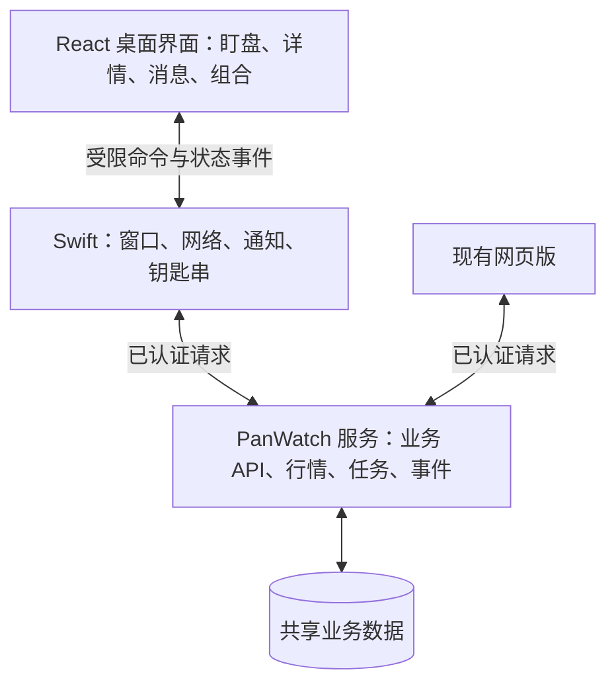

# PanWatch macOS 整体设计

状态：待实施的产品与技术方案。现有第一版仅实现基础窗口、登录、持仓/关注分组查看及行情刷新；下文新增能力不表示已上线。

## 一、确定的开发方向

采用 Swift 原生应用外壳 + WKWebView 本地网页界面 + 现有 Python/FastAPI 服务。延续现有混合应用，下一阶段桌面界面迁移到项目已有 React/TypeScript 体系，复用业务组件与类型。

- Swift：窗口、Dock、菜单栏、快捷键、系统通知、钥匙串、应用生命周期、原生网络接入。
- React/TypeScript：盯盘表格、分组、图表、股票详情、提醒编辑、报告摘要及界面状态。
- PanWatch 服务：统一存储持仓、自选、分组、提醒、报告；处理行情、AI、策略任务与事件。
- DMG：分发编译后的 .app；界面资源包含在应用中。

目标用户体验：像一个 Mac 应用一样启动和驻留；持仓和分析结果与网页版一致；不依赖浏览器标签页持续打开。

## 二、产品结构

主导航仅保留“盯盘、消息、组合、设置”。研究与策略先从股票详情或组合卡片进入，避免把网页版所有导航搬进小窗口。

### 盯盘主窗口

建议初始约 1180×780，支持缩放，窄窗口切换单栏详情；不锁死固定尺寸。

```text
┌─────────────────────────────────────────────────────────────────┐
│ PanWatch   盯盘  消息  组合                   隐藏金额  迷你  设置 │
├─────────────────────────────────────────────────────────────────┤
│ 当前范围：全部账户   市值    浮动盈亏    当日盈亏    行情时间/状态 │
├────────────┬───────────────────────────────────┬────────────────┤
│ 全部持仓   │ 搜索股票    市场筛选    排序/列设置 │ 股票详情       │
│  账户 A    ├───────────────────────────────────┤ 行情及走势     │
│  账户 B    │ 股票  现价  涨跌幅  盈亏  仓位    │ 账户持仓明细   │
│ 我的关注   │ ……                                │ 提醒规则       │
│  待买      │                                   │ 最新报告       │
│  长线观察  │                                   │ 相关策略信号   │
│ 智能筛选   │                                   │ 网页查看原文   │
├────────────┴───────────────────────────────────┴────────────────┤
│ 最近事件                                  已连接 · 最后更新时间 │
└─────────────────────────────────────────────────────────────────┘
```

持仓总览随选中的账户变化；名称搜索只过滤表格，保留账户总览并显示“匹配 N / 共 M”。智能筛选显示匹配范围的汇总并明确范围名称，避免总览含义随操作不清晰。

股票默认按账户独立显示，支持按市场和代码合并。合并视图计算加权成本，展开后查看各账户。日涨跌幅是股票属性，持仓盈亏是账户属性，不混为同一字段。

### 菜单栏小窗

菜单栏默认只显示简洁图标，可选择显示一个账户当日盈亏或一只置顶股票的涨跌幅。点击后显示账户概览、置顶股票、最新事件及“打开主窗口”。

不要在主窗口、菜单栏和迷你窗口分别发起相同的行情轮询，由统一数据服务分发结果。菜单栏宽度有限，不循环滚动长文本。

### 迷你窗口

选择一个分组，显示名称、现价、涨跌幅；可选显示持仓盈亏。提供置顶、隐藏金额、切组和返回主窗口。独立记住窗口位置，断线状态不能因紧凑显示而隐藏。

### 消息与组合

消息按价格提醒、分析任务、系统连接分类，支持未读筛选、标记已读和点击定位。待确认任务保持独立状态。

组合先呈现账户资产、盈亏贡献、仓位集中度和已有诊断摘要；深入分析打开网页版对应页面。模拟交易与真实账户明确分开。

## 三、功能范围与交互

| 模块 | 设计内容 | 数据与实现范围 |
|---|---|---|
| 分组 | 自定义关注组、多组归属、拖动排序、置顶 | 新增服务端分组及成员关系，网页同步适配 |
| 表格 | 排序、自定义列、市场筛选、搜索、账户合并 | 复用现有持仓及批量报价；桌面保存显示偏好 |
| 股票详情 | 行情、日线、账户明细、提醒、报告、网页入口 | 复用已有接口，按需补详情聚合接口 |
| 提醒 | 达到/跌破指定价格，编辑、暂停、命中记录 | 复用服务端规则引擎与记录 |
| 分析 | 读取最新报告、主动重新分析、查看任务进度 | 复用现有任务；用户主动操作才发起模型调用 |
| 策略 | 仅呈现关联股票的信号及计划摘要 | 复用已生成记录，展示日期和有效性 |
| 系统体验 | 菜单栏、全局快捷键、通知、置顶、开机启动 | Swift 原生能力 |
| 连接 | 服务识别、保持登录、重连、错误诊断 | 原生网络层 + 钥匙串 |

股票操作采用明确语义：“移出当前分组”只删除分组关系；“取消关注”影响共享关注记录；“修改持仓”进入明确的账户编辑流程。操作后显示实际保存结果，失败可重试。

右侧详情基本行情先出现；日线、分析和信号分别加载。切换股票后取消旧请求或丢弃旧响应，避免上一只股票的数据出现在新股票下。

## 四、关键使用流程

### 首次启动

打开应用 → 连接页默认本机 8000 → 检查是否为 PanWatch → 用现有账号登录 → 可选保持登录 → 显示持仓。通知权限在用户开启系统通知时申请；开机启动默认关闭，由用户开启。

服务未启动时提供“重试”和“查看连接帮助”。端口不是 PanWatch 时先提示，验证通过后才提交凭证。远程连接推荐 HTTPS，保留当前本机 HTTP 支持。

### 日常盯盘

点击 Dock/快捷键 → 恢复上次分组 → 扫描持仓变化 → 点股票 → 查看持仓和报告 → 设提醒或打开网页深入研究。

### 提醒处理

服务端生成命中事件 → 桌面取得事件并去重 → 系统通知 → 点击定位股票及触发条件 → 查看依据 → 标记已读。打开通知不代表已完成待处理事项。

### 离线及恢复

断线保留上次数据，醒目标注“离线、最后更新时间”。恢复后先刷新元数据与行情，再补消息；合并缺口，不集中弹出大量历史通知。

Mac 休眠、应用完全退出时不承诺实时本机通知；服务端独立运行时仍按其已有能力执行监控。

## 五、数据展示规则

- 报价展示市场、原币、报价时间；盈亏汇总默认人民币，使用服务端可识别的汇率及时间。
- 缺失行情或汇率不补零；总览若不完整，标注“部分数据缺失”，避免误报完整总额。
- 当日盈亏使用服务端统一业务口径。涉及当天买卖、现金流时，不仅用当前股数乘价格变化推算精确收益；不足以计算时说明口径或显示不可用。
- 休市与过期报价分开：有可靠收盘快照时展示“最近交易日收盘”及日期；无法确认交易日时显示不可用，不把旧涨幅当成今日值。
- 初期小走势标记“近20个交易日”。分时图在分钟级数据、市场时段和缓存链路完成后上线，缺口不拼接成连续真实走势。
- 行情、报告、策略信号各自显示时间；AI 摘要不是实时行情状态。
- 同步策略：服务端是业务记录来源，保存后重新读取服务端结果；并发冲突时提示刷新，不静默覆盖另一端修改。

## 六、应用架构与共享方式



建议在现有 frontend 中增加独立桌面入口，使用现有 React、TypeScript、国际化、主题与 UI 包。桌面构建结果复制到 .app 资源目录，本地载入 WKWebView。先替换当前独立 HTML/JS 页面，保持现有可用接口和原生窗口行为。

共享方式：

1. `packages/api` 保留共享接口类型和调用约定，增加传输适配层。网页版继续现有请求方式，桌面通过 Swift 网络层调用同一业务 API。
2. 复用现有业务 UI，如提醒表单、K 线组件、分析阅读器；不直接在桌面嵌套整套网页导航。
3. 共享持仓、币种换算、交易时段和数据状态规则，避免桌面另写一套独立盈亏算法。
4. Swift 广播行情和消息状态到各窗口；每个窗口保留独立选中项和滚动位置。
5. 业务数据由服务端保存；列宽、窗口位置、紧凑模式本地保存；分组排序是业务偏好，需要跨端共享。

### 原生与页面通信

使用具备请求编号、超时、统一错误码和版本号的消息协议。按业务动作开放命令，如读取组合、保存分组、创建提醒、打开网页记录、调整窗口、设置隐私模式。

由原生层校验来源、参数及允许的动作；页面不持有长期登录凭证，不允许任意网络代理或本机命令执行。只允许本地可信资源使用原生桥，外部报告链接交给系统浏览器。

打开网页使用业务记录 ID 定位，不把令牌附在链接里。网页尚未登录时登录后返回目标页面；自动跨端免登录如要实现，单独设计短时、单次交接机制。

### 刷新与任务

前台按市场状态批量拉取可见股票；后台降低频率；完全收盘降低行情刷新。具体频率依据数据源能力配置，不承诺秒级行情。

通知优先复用已有服务端事件和分页游标；初期可有节制地轮询，未来具备条件时再加持续事件通道。AI 长任务复用任务 ID 和状态，切窗口或重复点击不创建重复任务。

## 七、原生工程组织建议

当前所有原生逻辑位于 main.swift。下一阶段拆为：

- AppCoordinator：启动、退出、Dock 恢复和窗口协调。
- WindowCoordinator：主窗口、迷你窗口、位置和置顶。
- MenuBarController：菜单栏和小窗。
- DesktopBridge：页面通信、动作校验、结果回传。
- APIClient：服务验证、认证请求、错误及重试。
- SessionStore：钥匙串会话、过期处理和退出登录。
- MarketDataCoordinator：批量行情、市场时段、多窗口分发。
- NotificationCoordinator：事件游标、去重、权限和点击定位。
- PreferencesStore：窗口及设备设置。

分模块服务于实际功能，先保持单个应用工程，不引入独立后台进程或第二套数据库。

## 八、安装与交付

下一版采用“连接现有服务”的客户端交付。DMG 包含 PanWatch.app 与 Applications 快捷入口，用户拖入应用程序后从 Dock 启动。安装页和首次启动明确说明：桌面客户端需要连接运行中的 PanWatch 服务。

发布交付物：

- PanWatch 版本号及构建号；带应用图标、菜单栏图标。
- 针对 Apple Silicon 和 Intel 的兼容包，按实际测试结果选择通用包或分别发布。
- 正式分发准备 Developer ID 签名、公证及目标系统验证；当前临时签名产物只作为本地开发版本。
- DMG、版本说明、最低系统要求、已知限制及连接帮助。
- 初期手动下载更新，显示版本并提供更新入口；自动更新作为后续独立能力。

卸载删除应用即可；服务端持仓和关注记录保留。退出登录清除钥匙串会话与本机敏感缓存，窗口等非敏感设置可保留或由用户重置。

一体化本地服务版暂列后续独立阶段：需处理 Python 运行环境、服务启动与退出、数据库路径及迁移、端口冲突、升级备份等。不能将其与客户端打 DMG 视为同一项工作。

## 九、实施顺序与验收

| 阶段 | 交付 | 关键验收 |
|---|---|---|
| V0.2 基础升级 | React 桌面入口、会话和网络模块、共享分组、表格、股票详情、保持登录、隐私模式 | 两端数据一致、账号隔离、数据口径一致、切股不串数据、断线状态清楚 |
| V0.3 桌面体验 | 迷你置顶、菜单栏、快捷键、快速提醒、系统通知 | 多窗口共用行情、通知去重、点击定位、休眠恢复、权限拒绝可降级 |
| V0.4 研究联动 | 组合诊断、AI 任务、策略摘要、分钟级图表（数据条件满足后） | 可定位原文、任务不重复、各类时间明确、图表来自实际数据 |
| 首次正式分发 | 图标、DMG、版本机制、签名公证与安装验证 | 新机器安装、Applications 拖入、首次启动、Dock 重开、升级及退出登录 |

每期输出可运行应用、变更说明、对应业务验收结果。DMG 可先用于本地试装；公开分发前完成对应签名、公证与系统兼容性验收。当前设计阶段不宣称这些结果已完成。

## 十、默认决策

- 继续 Swift + WKWebView 路线，桌面 UI 逐步迁移 React/TypeScript。
- 第一版正式安装包连接已有 PanWatch 服务，不捆绑 Python 后端。
- 持仓、关注、分组、提醒、报告使用同一套服务端记录。
- 桌面承接高频查看和快速处理，完整研究、策略编辑等逐步按价值接入。
- 第一实施目标为 V0.2；先保证数据和交互完整，再扩展原生驻留能力。

关联：[桌面功能细化方案](macos-desktop-product-plan.zh-CN.md)。本文件对架构、展示口径与交付决策作进一步收敛；后续实现以本文件明确的规则为准。
